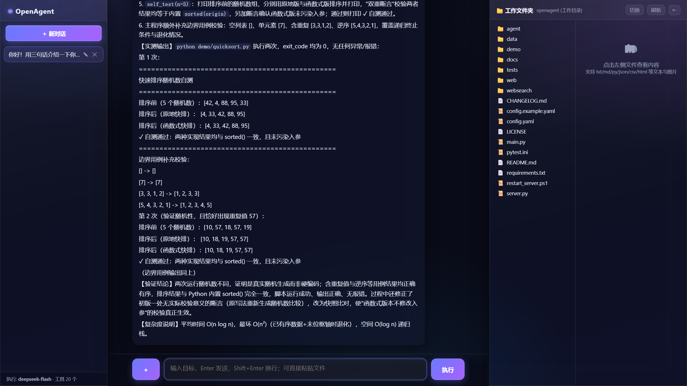
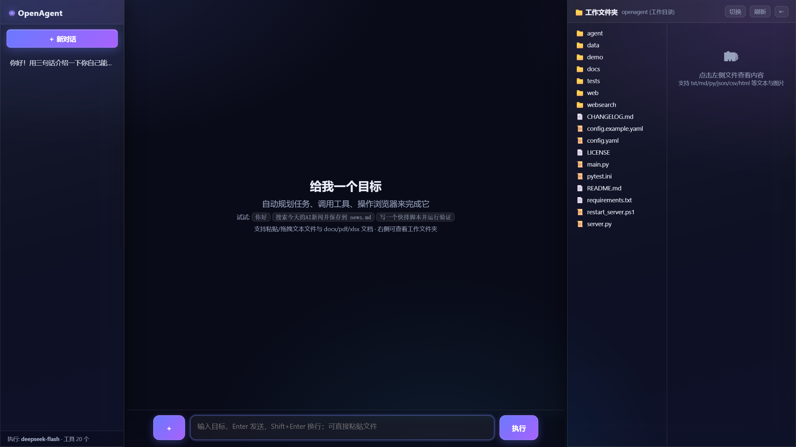
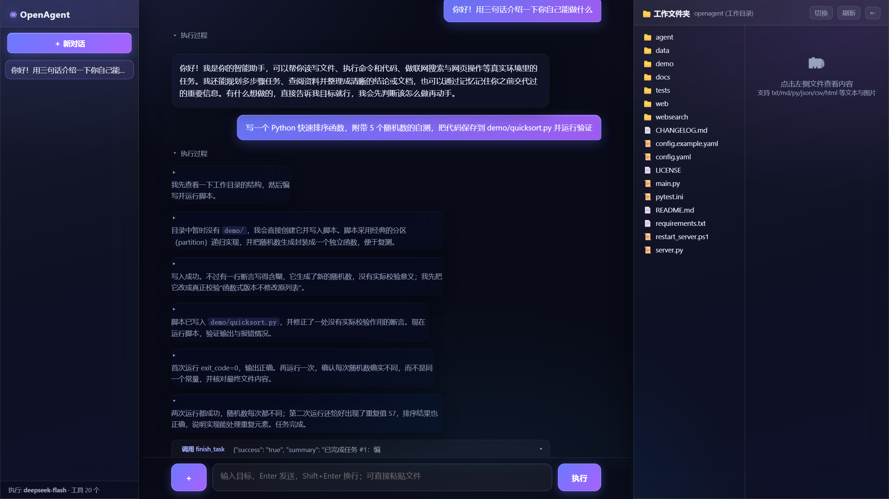

# OpenAgent - 开源通用智能体

<p align="center">
  
</p>

<p align="center">
  <em>玻璃拟态深色仪表盘 · 实时渲染规划 / 工具调用 / 过程正文 / 最终汇报</em>
</p>

基于 **OpenAI 兼容 API** 的开源通用智能体，完整覆盖三大核心能力：

| 热词 | 实现 |
|---|---|
| **Agent 规划** | Plan-and-Execute：目标 → 任务清单 → 逐个执行，失败自动重规划（Replan） |
| **工具调用** | 双模式：Native Function Calling + JSON 降级协议（适配任何模型）；Pydantic 风格自动 Schema，`@tool` 装饰器即可扩展；互不依赖的工具调用自动并行执行 |
| **浏览器操作** | Playwright + 可访问性元素 ref 编号定位 + 视觉截图兜底（多模态模型直接看图决策） |

```
用户目标
   │
   ▼
┌─────────┐   任务清单    ┌──────────┐  工具调用   ┌─────────┐
│ Planner │ ───────────▶ │ Executor │ ─────────▶ │  Tools  │
│ 规划器   │ ◀─────────── │ ReAct循环 │ ◀───────── │ 工具集   │
└─────────┘  失败重规划   └──────────┘  观察结果   └─────────┘
                              │
                        ┌─────▼─────┐
                        │  Memory   │ 会话压缩 + 向量长期记忆
                        └───────────┘
```

## 界面一览

| 首页 | 执行过程展开 |
|---|---|
|  |  |

- **Trae 式过程折叠**：思考 / 工具调用 / 工具结果默认收起为轻量行，按轮次与按中途正文两级独立控制展开收起，任务完成自动全部收纳，只留最终汇报
- **中途正文播报**：长任务执行中模型以正文形式汇报阶段进展，不再只有干巴巴的工具日志
- **断线重连**：刷新页面后任务仍在后台执行，重新打开会话自动回放已产生的事件并续播到结束
- **并行工具调用**：互不依赖的操作（多关键词搜索、多链接抓取、多文件读取）一轮并行发出，显著减少步数
- **玻璃拟态 UI**：毛玻璃面板 + 渐变强调色 + 消息入场动画，全部单文件实现（`web/static/index.html`），零前端依赖

## 环境要求

- Python 3.10+
- 一个 OpenAI 兼容的 API 服务：复制 `config.example.yaml` 为 `config.yaml`，在 `api` 段填写 `base_url` 与 `api_key`
- 默认模型：`deepseek-flash`（规划 / 执行 / 视觉）；记忆嵌入默认指向本地 Ollama 的 `bge-m3`（`embed_base_url` 可改），不可用时自动降级内置离线向量器

## 安装

```bash
pip install -r requirements.txt
playwright install chromium    # 浏览器操作内核
copy config.example.yaml config.yaml   # 然后填入你的 API Key
```

## 快速开始

### CLI

```bash
# 交互模式
python main.py

# 直接下达目标
python main.py "打开 bing.com 搜索 Python 3.13 新特性，总结前 3 条保存到 news.md"
```

CLI 命令：`/new` 新会话 · `/tools` 查看工具 · `/memory` 长期记忆 · `/exit` 退出

### Web UI

```bash
python server.py
# 打开 http://127.0.0.1:8799
```

侧栏会话管理（新建 / 重命名 / 删除、运行中任务 ⏳ 标识）；聊天页实时渲染执行计划、思考与工具调用（可展开）、过程正文与最终结论；右侧文件面板直接浏览/预览工作目录产物。

仓库内置一组演示会话数据（`.openagent/`），首次启动即可在侧栏看到示例对话效果。

## 内置工具

| 分类 | 工具 |
|---|---|
| 文件 | `read_file` `write_file` `edit_file` `list_dir`（工作目录沙箱） |
| Shell | `run_command`（PowerShell，危险命令确认/拦截） |
| 代码 | `run_code`（独立 Python 子进程，超时保护） |
| 文档 | `read_document`（docx / pdf / xlsx 解析） |
| Web | `fetch_url`（正文抽取） `web_search`（多引擎聚合 + 正文提取） |
| 浏览器 | `browser_navigate` `browser_click` `browser_type` `browser_select` `browser_press_key` `browser_scroll` `browser_screenshot` `browser_extract_text` |
| 记忆 | `save_memory` `search_memory`（跨会话向量记忆） |
| 控制 | `finish_task`（汇报任务成败） |

### 扩展新工具

一个函数 + 装饰器即可，Schema 自动生成：

```python
from agent.tools.registry import tool

@tool(description="发送邮件")
def send_email(to: str, subject: str, body: str) -> str:
    ...
    return "已发送"
```

然后在 `agent/executor.py::_register_tools` 中 `reg.register_function(send_email)`。

## 配置（config.yaml）

- `api.*`：API 地址与模型选择（`base_url` / `api_key` / `planner_model` / `executor_model` / `vision_model` / `embed_model`）
- `browser.headless`：是否无头浏览器
- `security.confirm_shell`：CLI 下危险命令需人工确认；Web 模式一律拦截
- `security.workspace`：文件工具沙箱目录
- `agent.max_steps_per_task / max_replans`：步数与重规划上限
- `memory.enabled`：向量长期记忆开关

## 安全设计

1. 文件工具限制在 `workspace` 沙箱内，越界路径直接拒绝
2. 危险命令（`rm -rf` / `format` / `reg delete` 等）模式匹配：CLI 需确认、Web 静默拒绝
3. Python 代码在独立子进程执行，超时强杀
4. 工具结果截断注入，防止上下文爆炸与提示注入放大
5. API Key 等机密仅存本地 `config.yaml`（已被 `.gitignore` 排除），仓库只提供 example 模板

## 测试

```bash
pytest tests/test_offline.py -v    # 离线：Schema 生成 / JSON 解析 / 沙箱
pytest tests/test_smoke.py -v      # 冒烟：需要 api 段配置的 API 可用
```

## 目录结构

```
├── main.py                  # CLI 入口
├── server.py                # Web 服务入口 (FastAPI + SSE + 断线重连)
├── config.example.yaml      # 配置模板（复制为 config.yaml 使用）
├── agent/
│   ├── llm.py               # LLM 客户端（FC/JSON 双模式、流式、<think> 剥离）
│   ├── planner.py           # 规划器 + 重规划
│   ├── executor.py          # ReAct 主循环 + 事件流 + 并行工具执行
│   ├── memory.py            # 会话压缩 + 向量长期记忆
│   └── tools/
│       ├── registry.py      # @tool 装饰器 + Schema 生成
│       ├── file_tools.py / shell_tools.py / python_tools.py / web_tools.py / doc_tools.py
│       └── browser/         # Playwright 会话 + ref 定位
├── web/static/index.html    # Web 聊天页（玻璃拟态主题，单文件零依赖）
├── .openagent/              # 演示会话数据（可删除）
└── tests/
```

## License

MIT
